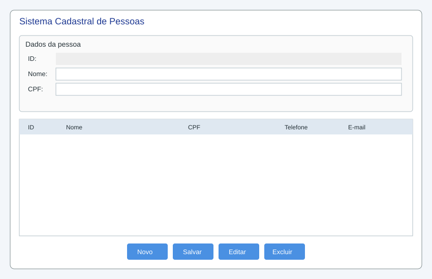

# Sistema Cadastral de Pessoas

## Descrição geral

Este projeto é um sistema desktop de cadastro de pessoas desenvolvido em Java com interface gráfica Swing e persistência JPA/Hibernate. Ele permite incluir, listar, editar e excluir registros em um banco de dados H2 local.

## Tecnologias

- Java 25
- Swing
- Jakarta Persistence (JPA)
- Hibernate 6
- Banco H2
- Maven
- JUnit 5

## Como executar

1. Instale o JDK 25.
2. Abra um terminal na pasta do projeto.
3. Execute `& "C:\Users\luiza\Tools\apache-maven-3.9.9\bin\mvn.cmd" clean test`.
4. Execute `& "C:\Users\luiza\Tools\apache-maven-3.9.9\bin\mvn.cmd" exec:java -Dexec.mainClass="br.faculdade.cadastro.Main"`.

O banco será criado automaticamente na pasta `data/cadastro.mv.db`.

## Manual do usuário

### Tela principal

A tela apresenta o formulário no topo, a tabela de pessoas no centro e os comandos na parte inferior.

<!-- FIGURA: substitua por print real obtido durante a execução da aplicação -->

**Legendas da imagem:**

1. **Dados da pessoa:** área reservada aos campos Nome, CPF, Telefone e E-mail.
2. **Tabela:** mostra todas as pessoas armazenadas no banco.
3. **Novo:** limpa o formulário para iniciar um novo cadastro.
4. **Salvar:** inclui ou atualiza a pessoa preenchida no formulário.
5. **Editar:** transfere os dados da linha selecionada para o formulário.
6. **Excluir:** remove, após confirmação, a pessoa selecionada.

### Incluir pessoa

1. Clique em **Novo**.
2. Digite o nome e o CPF; esses campos são obrigatórios.
3. Digite opcionalmente telefone e e-mail.
4. Clique em **Salvar**.
5. Confirme a mensagem de sucesso. A pessoa aparecerá na tabela.

### Consultar pessoa

Use a barra de rolagem da tabela para localizar o registro. A tabela é organizada por nome.

### Editar pessoa

1. Selecione uma linha na tabela.
2. Clique em **Editar**.
3. Altere os campos desejados.
4. Clique em **Salvar**.

### Excluir pessoa

1. Selecione uma linha na tabela.
2. Clique em **Excluir**.
3. Confirme a ação na janela de confirmação.

## Conclusões gerais

O sistema demonstra na prática os principais conceitos de JPA e interface gráfica Swing: mapeamento objeto-relacional, transações, consultas JPQL, reutilização de componentes visuais, validações e operações CRUD. A arquitetura separa entidade, acesso a dados e interface, facilitando manutenção e testes.
