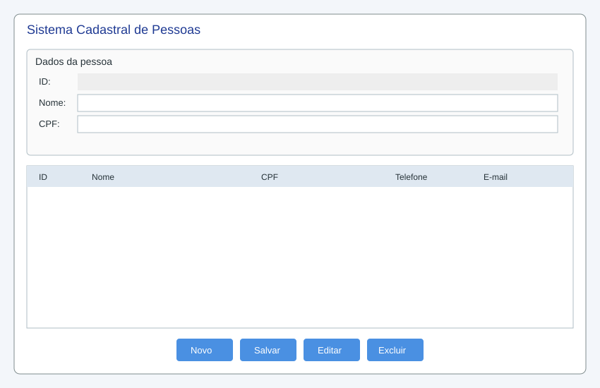

# Relatório do Sistema Cadastral de Pessoas

## 1. Descrição geral do sistema

O sistema é uma aplicação desktop acadêmica para cadastrar pessoas. A interface foi desenvolvida com Swing e permite incluir, consultar, editar e excluir registros. A persistência é realizada por JPA com Hibernate e banco de dados H2. Os principais componentes são:

- **Pessoa:** entidade JPA que representa uma pessoa cadastrada.
- **PessoaRepository:** componente responsável pelas operações de banco.
- **PessoaFrame:** interface gráfica que oferece os comandos ao usuário.
- **Main:** inicializa Swing e abre a janela principal.
- **PessoaRepositoryTest:** testes automatizados das operações de persistência.

### Operações disponíveis

- **Incluir:** cria uma nova pessoa quando nome e CPF são informados.
- **Consultar:** lista pessoas ordenadas pelo nome.
- **Editar:** altera os dados de uma pessoa selecionada.
- **Excluir:** remove uma pessoa após confirmação.

## 2. Códigos principais comentados

Os códigos principais foram escritos com comentários em quase todas as linhas para explicar suas responsabilidades. Eles estão disponíveis nos seguintes arquivos:

- [Classe Pessoa](src/main/java/br/faculdade/cadastro/model/Pessoa.java)
- [Repositório JPA](src/main/java/br/faculdade/cadastro/repository/PessoaRepository.java)
- [Interface Swing](src/main/java/br/faculdade/cadastro/ui/PessoaFrame.java)
- [Classe principal](src/main/java/br/faculdade/cadastro/Main.java)
- [Testes JUnit](src/test/java/br/faculdade/cadastro/PessoaRepositoryTest.java)
- [Configuração JPA](src/main/resources/META-INF/persistence.xml)
- [Configuração Maven](pom.xml)

## 3. Manual do usuário

### 3.1 Tela principal ilustrada



**Comentários sobre a tela:**

1. **Área Dados da pessoa:** recebe ID, Nome, CPF, Telefone e E-mail.
2. **Campo ID:** aparece preenchido somente durante uma edição.
3. **Tabela:** apresenta os registros existentes.
4. **Botão Novo:** limpa o formulário.
5. **Botão Salvar:** inclui ou altera o registro.
6. **Botão Editar:** carrega a pessoa selecionada no formulário.
7. **Botão Excluir:** remove a pessoa após confirmação.

### 3.2 Inclusão

1. Selecione **Novo**.
2. Informe **Nome** e **CPF**.
3. Informe **Telefone** e **E-mail**, se desejar.
4. Selecione **Salvar**.
5. Leia a mensagem de confirmação.

### 3.3 Consulta

Examine a tabela central. Os registros são exibidos em ordem alfabética pelo nome.

### 3.4 Alteração

1. Selecione a linha desejada.
2. Selecione **Editar**.
3. Altere os campos.
4. Selecione **Salvar**.

### 3.5 Exclusão

1. Selecione a linha desejada.
2. Selecione **Excluir**.
3. Confirme a remoção.

## 4. Execução

Use os seguintes comandos no terminal aberto na pasta do projeto:

```powershell
& "C:\Users\SeuUsuarioWindows\Tools\apache-maven-3.9.9\bin\mvn.cmd" test
& "C:\Users\SeuUsuarioWindows\Tools\apache-maven-3.9.9\bin\mvn.cmd" exec:java "-Dexec.mainClass=br.faculdade.cadastro.Main"
```

## 5. Testes

Foram executados dois testes automatizados de repositório:

- Inclusão e consulta de pessoa.
- Atualização e exclusão de pessoa.

Resultado da última execução: **2 testes, 0 falhas, 0 erros e 0 ignorados**.

## 6. Conclusões gerais

O projeto demonstrou a integração entre uma interface Swing e persistência JPA/Hibernate. A separação em entidades, repositório e interface melhora a organização do código e facilita novas extensões. Durante os testes, o sistema confirmou inclusão, busca, alteração e exclusão no banco H2.
